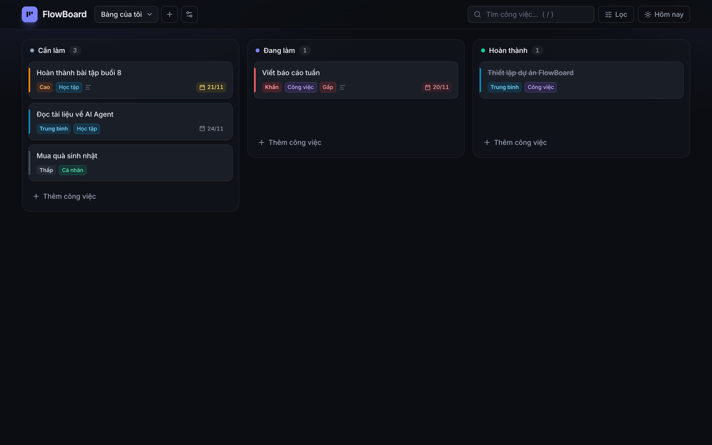

# FlowBoard

Bảng Kanban cá nhân chạy hoàn toàn trên trình duyệt: ba cột **Cần làm → Đang làm → Hoàn thành**, kéo thả,
hạn chót, độ ưu tiên, nhãn màu, tìm kiếm/lọc, chế độ tập trung **Hôm nay** và màu nhấn riêng cho từng bảng.
Dữ liệu lưu trong `localStorage` — không backend, không đăng nhập.

> Bài tập buổi 8 khóa học AI Agent, xây dựng theo phương pháp **Agentic Engineering** với plugin Superpowers:
> Brainstorm → Spec → Implementation Plan → Code theo plan (TDD) → Review → Bàn giao có bằng chứng.



## Tính năng

- 3 cột cố định; tạo, sửa, xóa (có xác nhận) công việc.
- Kéo thả bằng chuột, cảm ứng (nhấn giữ) và **bàn phím** (Space nhấc, ←/→ đổi cột, ↑/↓ đổi vị trí, Space thả).
- Menu “Chuyển sang…” trên từng thẻ — cách đổi cột nhanh trên điện thoại.
- Hạn chót (tô đỏ khi quá hạn, vàng khi đến hạn hôm nay), độ ưu tiên (Thấp / Trung bình / Cao / Khẩn), nhãn màu và tạo nhãn mới.
- Tìm kiếm không phân biệt dấu (“bao cao” tìm được “Báo cáo”), phím tắt `/`.
- Lọc theo ưu tiên, nhãn, hạn chót (quá hạn, hôm nay, 7 ngày tới, không có hạn).
- Chế độ **Hôm nay**: việc đến hạn/quá hạn + việc đã xong hôm nay, kèm thanh tiến độ.
- Nhiều bảng, mỗi bảng một màu nhấn (Indigo, Tím, Xanh dương, Ngọc lục bảo, Hổ phách, Hồng).
- Dữ liệu hỏng được sao lưu (`flowboard:backup-<thời gian>`) và app vẫn mở bình thường.
- Dark mode, responsive (mobile dùng tab chuyển cột), tôn trọng `prefers-reduced-motion`.

## Công nghệ

Vite · React 19 · TypeScript (strict) · Tailwind CSS v4 · Zustand · zod · dnd-kit · lucide-react ·
Vitest + Testing Library · Playwright.

## Chạy dự án

```bash
npm install
npm run dev          # http://localhost:5173
```

## Kiểm thử

```bash
npm run check        # lint + typecheck + unit/component test + build
npm run test:e2e     # Playwright (desktop + mobile Pixel 7), tự build và chạy preview
BASE_URL=https://<domain>.vercel.app npm run test:e2e   # chạy E2E trên bản đã deploy
```

Lần đầu trên máy mới có thể cần `npx playwright install chromium`.

## Deploy lên Vercel

1. Vào [vercel.com/new](https://vercel.com/new), import repo `dorai4vn/flowboard-kanban`.
2. Framework tự nhận **Vite** (đã cấu hình trong `vercel.json`: build `npm run build`, output `dist`). Không cần biến môi trường.
3. Deploy, rồi kiểm tra bằng `BASE_URL=<url> npm run test:e2e`.

## Cấu trúc

```
src/domain/      Logic thuần (bảng, công việc, lọc, ngày, schema, dữ liệu mẫu) — trọng tâm unit test
src/store/       Zustand store + lưu/khôi phục localStorage
src/components/  Giao diện (Header, FilterBar, BoardView, Column, TaskCard, TaskDialog…)
tests/e2e/       Playwright
docs/            Spec, Plan, báo cáo kiểm thử, báo cáo review, ảnh chụp màn hình
```

## Tài liệu quy trình (bằng chứng nộp bài)

- Spec: [docs/superpowers/specs/2026-11-21-flowboard-design.md](docs/superpowers/specs/2026-11-21-flowboard-design.md)
- Implementation Plan: [docs/superpowers/plans/2026-11-21-flowboard-mvp.md](docs/superpowers/plans/2026-11-21-flowboard-mvp.md)
- Báo cáo kiểm thử: [docs/test-report.md](docs/test-report.md)
- Báo cáo review: [docs/review-report.md](docs/review-report.md)
