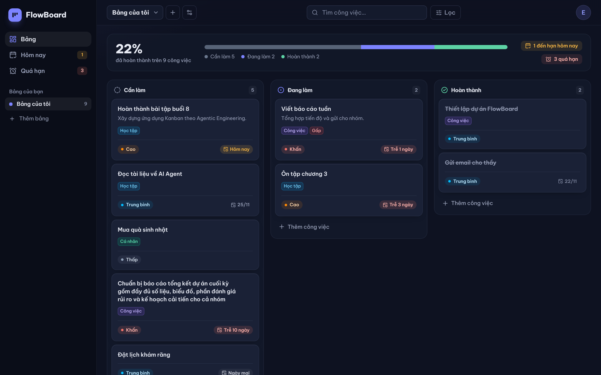

# FlowBoard

Bảng Kanban cá nhân chạy hoàn toàn trên trình duyệt: ba cột **Cần làm → Đang làm → Hoàn thành**, kéo thả,
hạn chót, độ ưu tiên, nhãn màu, tìm kiếm/lọc, chế độ tập trung **Hôm nay** và màu nhấn riêng cho từng bảng.
**Buổi 9 (nhánh `claude/m9-supabase`):** dữ liệu lưu trên **Supabase PostgreSQL**, đăng nhập bằng
**Google**, mỗi tài khoản chỉ thấy dữ liệu của mình nhờ **Row Level Security**.

> Bài tập buổi 8 khóa học AI Agent, xây dựng theo phương pháp **Agentic Engineering** với plugin Superpowers:
> Brainstorm → Spec → Implementation Plan → Code theo plan (TDD) → Review → Bàn giao có bằng chứng.



## Tính năng

- 3 cột cố định; tạo, sửa, xóa (có xác nhận) công việc.
- Kéo thả bằng chuột, cảm ứng (nhấn giữ) và **bàn phím** (Space nhấc, ←/→ đổi cột, ↑/↓ đổi vị trí, Space thả).
- Menu “Chuyển sang…” trên từng thẻ — cách đổi cột nhanh trên điện thoại.
- Hạn chót (tô đỏ khi quá hạn, vàng khi đến hạn hôm nay), độ ưu tiên (Thấp / Trung bình / Cao / Khẩn), nhãn màu và tạo nhãn mới.
- Tìm kiếm không phân biệt dấu (“bao cao” tìm được “Báo cáo”), phím tắt `/`.
- Lọc theo ưu tiên, nhãn, hạn chót (quá hạn, hôm nay, 7 ngày tới, không có hạn).
- **Buổi 10:** chế độ xem **Hôm nay** và **Quá hạn** gom việc từ mọi bảng (bộ đếm trên thanh điều hướng, đánh dấu hoàn thành một chạm, nhãn “Trễ N ngày”).
- Giao diện mới: sidebar + thanh điều hướng dưới trên mobile, font Be Vietnam Pro, badge ưu tiên/hạn chót rõ ràng.
- Nhiều bảng, mỗi bảng một màu nhấn (Indigo, Tím, Xanh dương, Ngọc lục bảo, Hổ phách, Hồng).
- Đăng nhập Google (Supabase Auth, PKCE); đăng xuất/đổi tài khoản xóa ngay dữ liệu đang hiển thị.
- Lưu lạc quan: thao tác hiện ngay, ghi lên server lần lượt; lỗi thì hoàn tác và báo “Không lưu được thay đổi, đã hoàn tác.”
- Mất mạng: chế độ chỉ đọc kèm banner.
- **Buổi 11:** **Trợ lý AI** (OpenAI Agents SDK, chạy phía server): đọc/tạo/sửa bảng và công việc bằng tiếng Việt; xóa luôn cần bạn bấm xác nhận — được cưỡng chế ở backend (Postgres), không chỉ bằng lời nhắc.
- Dark mode, responsive (mobile dùng tab chuyển cột), tôn trọng `prefers-reduced-motion`.

## Công nghệ

Vite · React 19 · TypeScript (strict) · Tailwind CSS v4 · Zustand · dnd-kit · lucide-react ·
Supabase (Postgres, Auth, RLS, supabase-js) · Vitest + Testing Library · pgTAP · Playwright.

## Chạy dự án

Cấu hình Supabase + Google: xem **[docs/m9-setup-guide.md](docs/m9-setup-guide.md)**.

```bash
npm install
cp .env.example .env.local   # điền VITE_SUPABASE_URL + VITE_SUPABASE_PUBLISHABLE_KEY (không bao giờ dùng secret key)
npm run dev                  # http://localhost:5173
```

## Kiểm thử

```bash
npm run check             # lint + typecheck + unit/component test + build
npm run db:start          # Supabase Local (cần Docker) — dùng cho 3 lệnh dưới
npm run test:db           # pgTAP: RLS + RPC
npm run test:integration  # repository thật với 2 user trên Supabase Local
npm run test:e2e          # Playwright (desktop + mobile) trên Supabase Local
npm run check:secrets     # quét secret trong file đã track và dist/
npm run test:agent-live   # Trợ lý AI với model OpenAI thật (cần OPENAI_API_KEY, tốn token)
```

Lần đầu trên máy mới có thể cần `npx playwright install chromium`.

## Deploy lên Vercel

1. Vào [vercel.com/new](https://vercel.com/new), import repo `dorai4vn/flowboard-kanban`.
2. Framework tự nhận **Vite** (đã cấu hình trong `vercel.json`: build `npm run build`, output `dist`).
3. Từ Buổi 9 cần biến môi trường `VITE_SUPABASE_URL` + `VITE_SUPABASE_PUBLISHABLE_KEY` và thêm domain Vercel vào
   Redirect URLs của Supabase + Authorized JavaScript origins của Google (xem mục 8 trong
   [docs/m9-setup-guide.md](docs/m9-setup-guide.md)). Production hiện vẫn chạy bản Buổi 8 từ `main`.
4. Buổi 11 (Trợ lý AI) cần thêm `OPENAI_API_KEY`, `AGENT_STATE_SECRET` và migration agent — xem
   [docs/m11-setup-guide.md](docs/m11-setup-guide.md).

## Cấu trúc

```
src/domain/      Logic thuần (bảng, công việc, lọc, ngày, dữ liệu mẫu) — trọng tâm unit test
src/data/        Mutation, mapper, BoardRepository (Supabase + bản giả cho test)
src/store/       Zustand store: hàng đợi ghi, hoàn tác, cô lập phiên theo user
src/auth/        AuthGate + Google login (Supabase Auth)
supabase/        config.toml, migrations (schema + RLS + RPC), rollbacks, tests pgTAP
server/agent/    Trợ lý AI: agent, tools, handlers, duyệt xóa (chỉ chạy phía server)
api/agent/       Vercel Functions: /api/agent/chat, /api/agent/approval
src/assistant/   Client gọi API trợ lý + state hội thoại
src/components/  Giao diện (Header, FilterBar, BoardView, Column, TaskCard, TaskDialog…)
tests/e2e/       Playwright
docs/            Spec, Plan, báo cáo kiểm thử, báo cáo review, ảnh chụp màn hình
```

## Tài liệu quy trình (bằng chứng nộp bài)

- Spec: [docs/superpowers/specs/2026-11-21-flowboard-design.md](docs/superpowers/specs/2026-11-21-flowboard-design.md)
- Implementation Plan: [docs/superpowers/plans/2026-11-21-flowboard-mvp.md](docs/superpowers/plans/2026-11-21-flowboard-mvp.md)
- Báo cáo kiểm thử: [docs/test-report.md](docs/test-report.md)
- Báo cáo review: [docs/review-report.md](docs/review-report.md)
- Buổi 9 — Spec: [docs/superpowers/specs/2026-11-22-flowboard-m9-supabase-design.md](docs/superpowers/specs/2026-11-22-flowboard-m9-supabase-design.md)
- Buổi 9 — Plan: [docs/superpowers/plans/2026-11-22-flowboard-m9-supabase.md](docs/superpowers/plans/2026-11-22-flowboard-m9-supabase.md)
- Buổi 9 — Hướng dẫn cài đặt: [docs/m9-setup-guide.md](docs/m9-setup-guide.md)
- Buổi 9 — Báo cáo kiểm thử: [docs/m9-test-report.md](docs/m9-test-report.md)
- Buổi 9 — Báo cáo review: [docs/m9-review-report.md](docs/m9-review-report.md)
- Buổi 10 — Spec/Plan: [docs/superpowers/specs/2026-11-22-flowboard-m10-ui-focus-design.md](docs/superpowers/specs/2026-11-22-flowboard-m10-ui-focus-design.md), [docs/superpowers/plans/2026-11-22-flowboard-m10-ui-focus.md](docs/superpowers/plans/2026-11-22-flowboard-m10-ui-focus.md)
- Buổi 10 — Báo cáo: [docs/m10-report.md](docs/m10-report.md)
- Buổi 11 — Spec/Plan: [docs/superpowers/specs/2026-11-23-flowboard-m11-ai-agent-design.md](docs/superpowers/specs/2026-11-23-flowboard-m11-ai-agent-design.md), [docs/superpowers/plans/2026-11-23-flowboard-m11-ai-agent.md](docs/superpowers/plans/2026-11-23-flowboard-m11-ai-agent.md)
- Buổi 11 — Cấu hình: [docs/m11-setup-guide.md](docs/m11-setup-guide.md) · Review migration: [docs/m11-migration-review.md](docs/m11-migration-review.md) · Runbook áp dụng: [docs/m11-apply-runbook.md](docs/m11-apply-runbook.md) · Báo cáo: [docs/m11-report.md](docs/m11-report.md) · Bản ghi model thật: [docs/m11-live-transcript.md](docs/m11-live-transcript.md)
